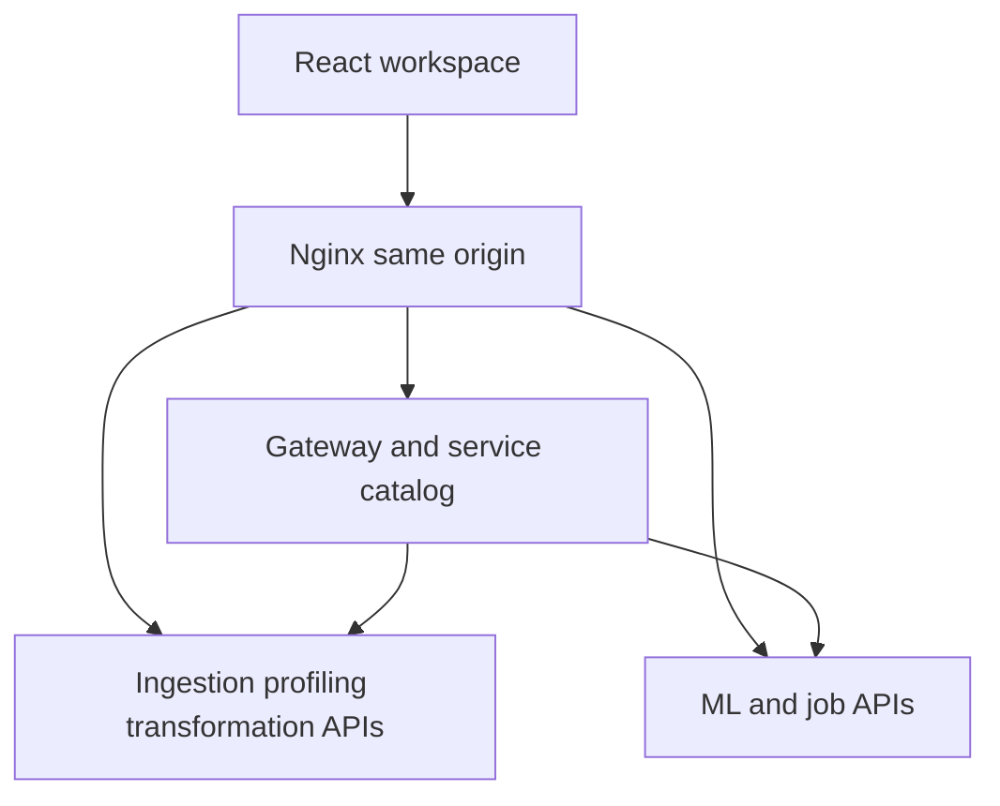

# Architecture and ownership

## Decision

Use one Git repository with independently runnable service packages. A monorepo does not make these services a monolith: each has a build context, lockfile, container, and HTTP boundary. Keep the number of actively developed services small and grow capability by complete workflows.

The original blueprint proposed a modular monolith. The user's later microservices requirement overrides that choice. This scaffold adds the new architecture without replacing existing implementation files.

## Request flow

This diagram describes the implemented bootstrap HTTP topology, not working data processing. The gateway performs bounded concurrent HTTP probes of a fixed service list. It reports an unavailable service honestly. Raw upstream addresses cannot be supplied by a browser.

## Future data flow

Ingestion will persist an immutable raw file and normalized dataset reference. Profiling will consume the version ID and record evidence. Transformation will apply a typed recipe and publish a new version. Analytics will aggregate that exact version; dashboard configuration will reference it. ML will reserve splits and fit preprocessing inside training folds. Exports will reference completed artifacts.

Dataset bytes should move through private object storage using authorized IDs and references. Containers must not rely on another service's private filesystem. Local storage adapters must expose the same logical contract.

## Database ownership

A PostgreSQL instance may host multiple service databases or schemas during development, but each service needs a separate minimal-privilege role and owns its migrations. No cross-service ORM imports, direct table writes, or migration chains. Shared wire contracts contain references, not ORM objects. The scaffold intentionally has no domain database models or migrations until ownership is designed for the first workflow.

## Messaging

Redis is initially a Celery task broker, not a claimed domain event bus. The shared event envelope is a design contract. Reliable publication requires persistent job records, a transactional outbox, idempotent consumers, and atomic artifact publication. Do not report those guarantees merely because a broker container starts.

## Production gaps

Session authentication, service authorization, request correlation middleware, real dependency readiness, persistence, data storage, quotas, job recovery, and business operations are future implementation work. Health reports startup only. Nginx binds localhost through Compose and the scaffold must remain local until these gaps are addressed.
